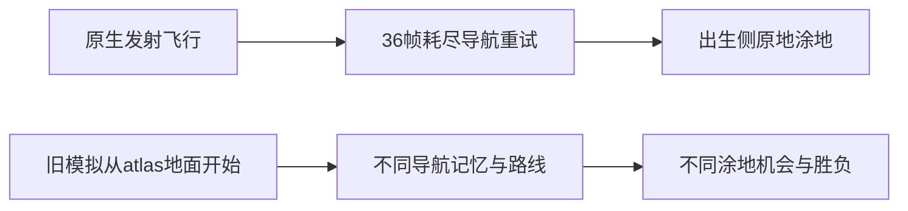

# S1 保真度与策略排名对照（2026-10-21）

<!-- S1_NATIVE_WINDOW_20261021 -->
本轮原生P0校准降低了短时域位置误差、补入脚下墨与按键重生，A5 Yagara预测恢复high-ground 12:0；**R1/R2仍与原生排名相反，保真度未签收**。最终66局的tau-b仍为.816497，且没有复现R1/R2的原生交战，不能用局部运动/涂地改善代替策略有效性验收。

## 原生 P0 校准窗口（2026-10-21）

使用 c0a03e4 签收的 v4 默认宿主 `work/a8/dmhost-arena-v15`，geometry、每案例新进程。共32次房间尝试：22次 collected、10次失败/取消，全部原件保留；并发案例生命周期峰值3房，资源压力最高1、新增swapout 0字节，关闭后无原生进程。没有改对战/策略目录，没有恢复原生T1；冻结策略仅在离线模拟中调用。

收集完成不等于全部 P0 验收。已校准首次发射、按键重生、人形响应/AP锚点、自由空中有效运动及局部脚下墨/墨刃场景碰撞。完整计分域、世界墨图映射、部分拐角/相机状态和蓄力首伤残差仍未签收。派生模型与原件均留在 `work/sim/window-20261021/`，提交不含游戏数据、地图或截图。

### 位置与状态短时域：同一历史留出集，因果重置

比较当前离线诊断修复后的旧模型与本轮模型，均保留落地包支撑约束，避免把上轮穿地板修复重复算成本轮收益。三图固定 round-001 留出局，N=30/60/120/300；按原生 sample frame、过去可交付包初始化，不复制窗口内状态。统计为按有效采样数合并的 RMSE/MAE，原生墨图/投射物与武器阶段仍不可完全初始化。

| N | 窗口数 | 位置RMSE 前→后 | 身体朝向MAE 前→后 | 墨量MAE 前→后 | HP MAE 前→后 |
| ---: | ---: | ---: | ---: | ---: | ---: |
| 30 | 987 | 0.3779 → 0.3476 | 0.2057 → 0.2046 | 0.01166 → 0.01166 | 0.00403 → 0.00408 |
| 60 | 494 | 0.7907 → 0.6110 | 0.2206 → 0.2188 | 0.01682 → 0.01682 | 0.00822 → 0.00873 |
| 120 | 243 | 0.8914 → 0.7661 | 0.2374 → 0.2358 | 0.02693 → 0.02660 | 0.02099 → 0.02102 |
| 300 | 94 | 1.7991 → 1.7594 | 0.2982 → 0.2967 | 0.05212 → 0.05157 | 0.03884 → 0.04038 |

| 图 | N | 位置RMSE 前→后 | 本轮采样P95 | 本轮窗口RMSE P95 | 本轮末端P95 |
| ---: | ---: | ---: | ---: | ---: | ---: |
| 1 | 30 | 0.3567 → 0.3271 | 0.5393 | 0.5408 | 0.7165 |
| 1 | 60 | 0.6558 → 0.4775 | 0.7795 | 0.7284 | 0.9239 |
| 1 | 120 | 0.7850 → 0.6506 | 1.2236 | 1.0273 | 1.8132 |
| 1 | 300 | 1.6272 → 1.6605 | 3.1605 | 3.1766 | 5.6742 |
| 2 | 30 | 0.3739 → 0.3357 | 0.5390 | 0.5588 | 0.7338 |
| 2 | 60 | 0.8617 → 0.6895 | 0.8741 | 0.8708 | 1.1646 |
| 2 | 120 | 0.8423 → 0.7397 | 1.4497 | 1.4335 | 2.1687 |
| 2 | 300 | 1.5121 → 1.4775 | 3.0439 | 2.5729 | 5.4296 |
| 3 | 30 | 0.3995 → 0.3749 | 0.6682 | 0.6850 | 0.8805 |
| 3 | 60 | 0.8340 → 0.6423 | 1.1115 | 1.1143 | 1.7613 |
| 3 | 120 | 1.0161 → 0.8780 | 1.9019 | 1.7020 | 3.0784 |
| 3 | 300 | 2.1578 → 2.0601 | 4.9717 | 4.1615 | 7.7228 |

每图的采样P95、窗口RMSE P95、末端分布及形态误差在 `horizon-final.json`，不将三图P95再取平均冒充合并分布。HP并非各时域一致改善；排名和涂地不由位置指标自动推定。

### 原生校准项与独立重复

人形杆量采用径向四次方：AP0满杆约.096，.5杆约.006、.85杆约.050112；(1,.25)方向仍为4:1，不能逐轴取四次方。人形加速/制动为.010/.008；run AP0/19/57锚点速度约.096/.121417/.144，AP3/10/38仅插值，charge/recovery/swim未据此改配装曲线。空中候选由地图1/2角色0的4段、22个自由空中采样拟合，识别时使用过去已交付native yaw以分离相机变化；有效系数不当作游戏C++默认值。

| 新原生运动房 | 75帧启动/制动窗口位置RMSE 前→后 | 证据层级 |
| --- | ---: | --- |
| p0_motion-ap19 | 0.6682 → 0.0583 | AP19过渡/AP57锚点参与拟合，校准重算 |
| p0-motion-ap0 | 0.4739 → 0.0379 | 独立AP0房验证 |
| p0-motion-ap57 | 1.0086 → 0.1212 | AP19过渡/AP57锚点参与拟合，校准重算 |

| 中立首发射（首240帧） | 位置RMSE 前→后 |
| --- | ---: |
| 图1双侧 | 12.7072 → 0.0000 |
| 图2双侧 | 17.5102 → 0.0385 |
| 图3双侧 | 14.5427 → 0.1260 |

中立验证取新房前240帧；图1/2的房间后来在Judge收集器失败，前缀测量完整，不能把整房标成通过。发射模型包含首次接地后残余推力，不再从atlas地面起跑。

**非中立发射仍有反例**：留出图3 role1前推.85，接地前RMSE 0.0204，首240帧整体 12.9930 → 2.8707、最大 6.5001。目前中立轨迹高度驱动与前推跨过落点后的地形/下落交互不充分，不能用中立低误差签收整个发射模型。

| 真实重生房 | 发射台就绪后位置RMSE 前→后 | alive不一致率 前→后 |
| --- | ---: | ---: |
| p0-combat-dry-ap0 | 63.9432 → 0.0346 | 3.797% → 0.000% |
| p0-respawn-neutral-then-edge | 48.7827 → 0.0617 | 58.376% → 0.000% |
| p0-combat-range6-ap0 | 61.7180 → 0.0000 | 2.353% → 0.000% |

重生对照以首个原生死亡样本为条件起点，之后只重放输入。两房ready首包均在death首包后392帧；第三房中立900帧仍dead/HP1/墨1，单次ZR才发射。模型采用392帧就绪、460帧解锁候选及有限发射；精确内部锁定、持续按住ZR跨解锁、图2/3真实重生和重生配装未签收。三房接地后均无后续状态注入；前两房参与时序校准，首次发射曲线来源于另三个开局房。

| 涂地世界接触扫描 | 独立重复 | 全部已观测点F1 前→后 | 留出两行F1 前→后 |
| --- | --- | ---: | ---: |
| 轻挥12 | 首三行拟合，末两行留出 | 0.615 → 0.714 | 0.533 → 0.625 |
| 满蓄21 | 首三行拟合，末两行留出 | 0.400 → 0.769 | 0.364 → 0.778 |
| 满蓄21 | 是 | 0.286 → 0.629 | 0.400 → 0.706 |
| 轻挥12 | 是 | 0.667 → 0.720 | 0.571 → 0.667 |

轻/满脚下墨的粗网格有效半径均为1.5，接触有效出现延迟14/11帧候选，包含传感/采样延迟。按实际XYZ、contact0/4取每世界格首个样本，不把未走过的格补成未涂；每房89个代表点不是完整地面掩码。场景碰撞采用CoreIndex决定整条墨刃终止，非核心球碰场景后永久遮断以防下一帧穿墙复活；此候选在满蓄独立重复改善明显，仍不是原生内部实现证明。

| Yagara固定落点涂地 | 原生终局% 两侧 | 旧模型% 两侧 | 本轮% 两侧 |
| --- | ---: | ---: | ---: |
| hold12 × 1 | 0.700 / 0.600 | 0.369 / 0.379 | 0.419 / 0.429 |
| hold12 × 8 | 1.000 / 0.900 | 0.279 / 0.279 | 0.329 / 0.329 |
| hold21 × 1 | 0.800 / 0.900 | 0.150 / 0.150 | 0.200 / 0.200 |

中立/仅role0射击纹理对照，新增R通道阈值像素：轻挥 4163、满蓄 6023，G均保持192；证实可读到局部原生涂地支持，仍无UV→世界面积/计分域映射。上述世界接触F1与终局%显示局部改善和明显面积低估并存；没有按比分缩放分母或特殊充能。

### 伤害、墨量与未解决的拐角

| 新原生房 | 首伤阶段 | 原生首伤区间 | 5帧模型区间越界 前/后 | 相对首个损血包 前/后 |
| --- | --- | --- | ---: | ---: |
| p0-combat-dry-ap0 | measure-light-timing | [3093, 3096] | 0 / 0 | -1 / -1帧 |
| p0-combat-dry-ap0 | measure-full-timing | [3161, 3164] | 1 / 1 | 1 / 1帧 |
| p0-respawn-neutral-then-edge | measure-light-timing | [3127, 3130] | 0 / 0 | -1 / -1帧 |
| p0-respawn-neutral-then-edge | measure-full-timing | [3199, 3201] | 2 / 2 | 2 / 2帧 |
| p0-combat-range6-ap0 | measure-light-timing | [3333, 3336] | 0 / 0 | -3 / -3帧 |
| p0-combat-range6-ap0 | measure-full-timing | [3405, 3405] | 2 / 2 | 2 / 2帧 |

近距实际1.070单位独立测得20+35=55，支持A1接触起点修正。轻挥原始无延迟模型早6–8帧，原5帧有效HP延迟在三个新房轻挥区间内；本轮未为对齐新房而调公共延迟。满蓄仍晚1–2帧，需要独立首刀/连刀相位与接触骨骼复测；满蓄发生在轻挥之后，原生损血被剩余HP截断，不能拿.45/.675损血当名义满蓄伤害。新轻挥射手墨量MAE约.0003，满蓄约.0033，预扣/退款模型本轮保留。

拐角探针并非三图一致改善，`bends-horizon-final.json`保留全部分布。三图新开局左杆(1,.25)、右杆/gyro为零时native view yaw显著变化；经手动align的平地探针没有同样漂移。尚未分离相机初始/跟随状态与身体碰撞，不能据不同坐标的两条路线回调胶囊半径或台阶阈值。完整原生墨图、地形小物体精确支撑和墨色差速仍是P0/P1义务。

### 冻结策略排名：66局完整10800帧预测对局

本轮只重跑反例所需分层：A5 Yagara双侧12局，R1/R2/R3各三图原生观测侧18局。每层seed0固定，seed1..5为±.15 XZ、±.03rad yaw敏感性；不是原生独立随机试验。首次发射由独立P0中立房拟合，观测使用通用4帧采样/1帧交付假设，**不注入历史策略开局观测、轨迹或逐局时钟**。出生偏移保持在有限发射模型中，不因第一帧重置丢失。R0/R4与A5其它两图没有重跑，不把子集结果冒充全量132局重验。

| 对阵/图/侧 | 原生A:B | 旧216局同分层A:B | 本轮A:B | 占地% 原生A/B | 本轮A/B | HUD倒下计数 原生A/B | 本轮A/B |
| --- | ---: | ---: | ---: | ---: | ---: | ---: | ---: |
| A5/3/0 | 0:11 | 5:1 | 0:6 | 1.164 / 2.545 | 0.338 / 2.689 | 0.00 / 0.00 | 0.00 / 0.00 |
| A5/3/1 | 0:11 | 5:1 | 0:6 | 1.173 / 2.918 | 0.336 / 2.757 | 0.00 / 0.00 | 0.00 / 0.00 |
| R1/1/1 | 0:1 | 4:2 | 6:0 | 11.700 / 12.000 | 3.704 / 0.482 | 1.00 / 1.00 | 0.00 / 0.00 |
| R1/2/1 | 0:1 | 0:6 | 4:2 | 7.650 / 14.150 | 3.088 / 1.138 | 0.00 / 2.00 | 0.00 / 0.00 |
| R1/3/1 | 1:0 | 6:0 | 6:0 | 9.700 / 4.300 | 2.306 / 0.564 | 0.00 / 0.00 | 0.00 / 0.00 |
| R2/1/0 | 0:1 | 4:2 | 6:0 | 11.700 / 12.300 | 0.636 / 0.453 | 2.00 / 0.00 | 0.00 / 0.00 |
| R2/2/0 | 0:1 | 3:3 | 3:3 | 10.300 / 11.300 | 1.160 / 1.173 | 2.00 / 2.00 | 0.00 / 0.00 |
| R2/3/0 | 1:0 | 4:2 | 6:0 | 11.100 / 10.300 | 2.719 / 0.723 | 1.00 / 1.00 | 0.00 / 0.00 |
| R3/1/1 | 1:0 | 6:0 | 6:0 | 17.100 / 11.400 | 4.196 / 0.482 | 0.00 / 0.00 | 0.00 / 0.00 |
| R3/2/1 | 1:0 | 4:2 | 6:0 | 15.100 / 11.100 | 13.320 / 1.138 | 0.00 / 0.00 | 0.00 / 0.00 |
| R3/3/1 | 1:0 | 6:0 | 6:0 | 15.200 / 11.800 | 13.168 / 0.564 | 0.00 / 0.00 | 0.00 / 0.00 |

共同bravo-v1对手下，alpha v1/v2/v3的原生强度为[0.3333333333333333, 0.3333333333333333, 1.0]，旧模拟为[0.5555555555555557, 0.6111111111111113, 0.8888888888888892]，本轮为[0.8888888888888892, 0.8333333333333336, 1.0]；Kendall tau-b **0.816497 → 0.816497**。保留原生v1/v2的BO3并列，不为断开的A5/R0/T1对阵图制造统一排名。BO3样本很小，tau与点胜率方向只作有效性诊断。

本轮完整原件：`comparison.json`、`analysis-v2.json`、`horizon-{before,final}.json`、`bends-horizon-{before,final}.json`、`ranks-final/*/{plan,result}.json`、`audit.json`。首轮66局 `ranks/` 作为发射/人形/涂地消融保留；最终模型在 `models-v2/`，首轮模型在 `models/`，不覆盖旧216局。


### 最终模型的路线反例复核

复核R1/R2各一个图1固定起点代表局；对应两组六起点共12次记录重放的轨迹digest全部逐位等于最终排名，记录器没有改变轨迹。原生仅在自身sample frame比较，角色映射到策略顺序，没有新增原生对局。闭环输入可能先不同，位置差不能单独识别地形碰撞。

| 局/角色 | 首次输入不同帧 | 首次位置差>1帧 | 到absZ<50 原生/模拟 | 首次可见 原生/模拟 | 高台首次 原生/模拟 |
| --- | ---: | ---: | --- | --- | --- |
| R1/图1/alpha | 2 | 113 | 1146 / 1174 | 2719 / None | None / None |
| R1/图1/bravo | 67 | 16 | 1088 / None | 2715 / None | 5670 / None |
| R2/图1/alpha | 1 | 104 | 1004 / None | 3102 / None | 3317 / None |
| R2/图1/bravo | 67 | 96 | 1036 / None | 2793 / None | None / None |

这里是闭环偏离定位；输入已经不同，不能据两条不同路线直接拟合物理碰撞。完整XYZ、相机和终点保留在`routes-comparison.json`；None表示整个窗口没有观测到。


R1 bravo在首次输入不同前已经出现发射位置差，优先怀疑受控原点/发射相位与包时钟的未识别差异，不能直接指定为地图错误。其16帧原生位置约`(-23.900,29.189,101.595)`，模型为`(-23.900,30.114,103.260)`。中立新房拟合成功没有覆盖历史T1全部附着相位。

这两个代表局的模拟bravo最终均滞留于出生侧约`(±20.057,7.5,±70.472)`，原生在约1000帧已进入absZ<50；模拟全局未见敌人，R1原生bravo却于5670帧进入高台。R2模拟alpha也留在相近出生侧。交战缺失与早期路线/出生侧滞留并存，不能仅修伤害时机来签收排名，也不能在输入已不同的地方把残差全部压到一个碰撞参数。首轮66局消融曾使R1/R2各为8:10，但未包含最终空中/重生与发射初值偏移修正；没有为追排名退回该版本。

### 收集失败、验证与停止边界

首次paint批有3房在Judge误送InGame投影器，随后6房取消，失败/取消均留在`paint/`及`owned-cancel.json`；没有把它们算成整局成功。修正后Yagara三房均到双端原生Winners。另1房近距准备阶段因敌墨干扰无法回满HP，改为干地开测，失败原件也保留。其余collected只表示各自测量段结束：UV检查点房并未跑到终局，运动/扫描房也不是原生BO3验收。

61项组件测试通过（`final-tests.log`），覆盖标量/向量差分、径向响应、墨刃非核心球遮断、发射初值偏移和重生时序/按键边沿模型；另有180帧离线策略CLI实际加载五份模型通过（`cli-smoke/`）。模型假设的单测不代替未测的原生持键/内部定时器。最终排名66个唯一情景均完整10800帧，源码/模型/策略hash在报告生成时重核验通过。未重跑CPU吞吐基准，下文速度表仍是历史测量。

本轮原生已关闭、未恢复T1，停止在窗口内。所有未签收项与下次具体对照列在 [calibration/PENDING.md](calibration/PENDING.md)，优先处理非中立发射首次接地、UV世界计分映射、相机状态与拐角支撑、满蓄首伤残差。不要用本轮模型继续宣称R1/R2强弱已可信，也不因tau较高忽略逐对阵方向与交战缺失。

---

## 2026-10-20 离线诊断与前阶段结果（历史保留）

以下至文末保留此前冻结结果与当时的停止状态；“本轮”“未启动原生”等叙述指对应历史阶段。

本轮完成 A5 Yagara、R1/R2 的离线反例诊断。**A5 反转的最早原因是开局协议不同：原生在飞行中耗尽导航重试，旧模拟从地面直接起跑。** 重建历史开局与采样时钟后，A5 Yagara 条件对照恢复 high-ground 12:0；R1 9:9、R2 11:6另1平，仍不支持原生排名一致性。没有按胜者调参，没有启动游戏。下方保留原216局预测基线，不用条件重建结果覆盖它。

## 本轮离线诊断：先定位首次分歧，再看胜负

只读原生28局：A5 Yagara22局及R1/R2各三局，按每端自己的position_sample_frame去重。主诊断新增70局完整10800帧模拟：14局原地面固定起点、8局开局重建固定起点、48局开局+采样时钟条件敏感性。14局原地面复算的胜者、占地、HUD计数和机制事件均与上一轮seed0逐项完全相同，确认记录器没有改变基线。

**A5 Yagara 的 high-ground 胜利不是占住中央高台的结果。** 22局双方X跨度均小于.004单位、没有横向路线、未到central_high、没有可见对手或HUD击倒。两侧实际最终落点约为 `(3.6,13.5,65.25)` / `(-3.6,13.5,-65.25)`，而atlas地面点是 `(6,13.5,74)` / `(-6,13.5,-74)`。两策略都在第12/24/36帧飞行过程中no_route，第36帧用完3次重规划并保留failed，落地后原地涂地。旧模拟省略整个过程，导航记忆和位置从开局就不同；其中一个固定侧的high-ground在模拟3270帧才进入高台，而对应原生全局未到。现有证据不支持把这次反转归因于中央高台本身不可达。



开局干预先用前120帧原生白名单观测恢复同一冻结策略的内部记忆，在120帧因果重置一次可观测状态，此后完全自由模拟。时钟干预只重用原生包的时间戳，从**过去的模拟快照**投影观测，不复制后续原生位置/HP；原生R1/R2包龄中位数2帧、P95为4帧、最大5帧，旧模拟总为0。前缀8880次策略动作逐项等于历史动作，最大差0。A5每侧只用首个开局，另20局审计其路线事实；每个条件的seed1..5在120帧施加原±.15XZ/±.03yaw扰动。它们不是已辨识的原生随机分布，也不是完成发射/重生/网络模型的证明。初始世界墨图、投射物及武器阶段仍只有明确估计；T1仅比较实测出生侧。

### 这轮能确定与尚不能确定的原因

- **开局协议已定位**：A5双侧从旧模型rush 10:2反转为条件high-ground 12:0，且同样不进入高台、无交战。仅重建开局、不加时钟的两个固定局也都恢复high-ground胜。
- **早期移动/支撑仍偏离**：重建后六个T1代表局的双方首次位置差>1单位出现在152–612帧，均早于首次原生可见敌人。R1 District00在648帧，alpha原生y=9.64而模拟y=12.76；另一端924帧原生y=12而模拟y=9.09。R2 Yagara在420帧，alpha原生y=14.45而模拟y=11.41。双方有提前掉落和滞留上层两种残差，不能用一个最大速度或台阶阈值补偿。跳跃/落地、攻击后移动、道具支撑和墨色/AP仍混淆，未按BO3结果挑参。
- **可见性规则实现没有重投影差异**：8个代表局133,200次原生策略观测，将相同原生轨迹送入现用adapter/projector及模拟索引sight网格，可见性与历史记录全部一致。它验证同一A3几何规则的实现一致，不是渲染器真实视线。条件闭环首次看见仍相差数百帧，位置/身体朝向/形态轨迹差异已经足以改变信息输入；不能为了胜率改FOV。
- **涂地与交战尚不保真**：即使A5路线恢复，rush平均网格占地.280%仍远低于原生1.168%，high-ground为2.040% vs2.732%。RomFS含FootSplashPaintParam、SplashPaintParam、SplashSpawnParam等参数，核心仍只有层化地面圆盘，缺少经验证的脚下/滴落/碰撞喷溅和原生计分域。仅最终比分不能识别这些变换。R1 District00固定条件局虽然同样判bravo占地胜，原生是bravo两次击倒alpha，模拟却反过来；胜负一致不足以签收机制。ZR时长/松开次数只作输入机会，不能冒充实际挥刀或真实涂地面积。

### 已修复：落地包外推穿地板

`reset_native`曾把已落地的最新包继续按上一采样区间的下落均速外推。R2 District00第720帧：最新包716帧已在y=9、contact=4，但旧外推到y=8.7494，低于地板，后续向下射线找不到上方支撑，形成虚假坠落。现在地面包的外推按静态支撑移动，空中外推跨过地面时落地；只使用过去包，不读取窗口中的原生状态。

同一120帧窗口、不删异常样本：位置RMSE **21.9191→.5948**，最大误差34.3807→.7401；六局前1920帧各16个重置窗口重算，R2 District00整体N30 RMSE **.5799→.3045**、N120 **3.9615→.8320**。其它残差保留在下表，R1 Yagara N120略退化，未宣称运动模型整体已校准。该改动修复诊断初始化，不改变自由对局核心的速度/伤害参数。

### 完整分层对照与路线/交战摘要


A/B顺序分别为rush/high-ground、alpha/bravo。以下是固定历史开局与包时钟条件下的诊断干预，不是已识别的发射/重生/网络模型。
原生只在自己的采样帧统计位置；停留用≤16帧间隔左保持估计。ZR时长/松开只代表涂地输入机会，不能观测原生真实涂地面积/时长。

| 对阵/图/出生侧 | 原生 A:B（平） | 原216局同分层 A:B（平） | 开局重建+采样时钟 A:B（平） | 固定起点赢家 地面→前缀→前缀+时钟 |
| --- | ---: | ---: | ---: | --- |
| A5/3/0 | 0:11 (0) | 5:1 (0) | 0:6 (0) | 0 → 1 → 1 |
| A5/3/1 | 0:11 (0) | 5:1 (0) | 0:6 (0) | 0 → 1 → 1 |
| R1/1/1 | 0:1 (0) | 4:2 (0) | 3:3 (0) | 0 → 1 → 0 |
| R1/2/1 | 0:1 (0) | 0:6 (0) | 3:3 (0) | 1 → 0 → 1 |
| R1/3/1 | 1:0 (0) | 6:0 (0) | 3:3 (0) | 0 → 1 → 1 |
| R2/1/0 | 0:1 (0) | 4:2 (0) | 4:2 (0) | 0 → 1 → 0 |
| R2/2/0 | 0:1 (0) | 3:3 (0) | 3:2 (1) | 0 → 0 → 1 |
| R2/3/0 | 1:0 (0) | 4:2 (0) | 4:2 (0) | 1 → 0 → 0 |

赢家0=A，1=B；侧=policy A在物理出生侧1时为1。T1只列原生实际观测侧，没有镜像伪造另一侧。

前缀逐次动作核对8880次，最大差0.0；原策略、配装、调用周期和超时均保留。

| 固定代表局 | 角色 | 高台首次到达 原生/地面/条件 | 高台停留帧 原生/条件 | 高台ZR输入帧 原生/条件 | 首次可见帧 原生/条件 | 120帧后松ZR次数 原生/条件 |
| --- | --- | --- | --- | --- | --- | --- |
| A5/3/0 | A | —/—/— | 0/0 | 0/0 | —/— | 203/250 |
| A5/3/0 | B | —/—/— | 0/0 | 0/0 | —/— | 14/119 |
| A5/3/1 | A | —/—/— | 0/0 | 0/0 | —/— | 212/194 |
| A5/3/1 | B | —/3270/— | 0/0 | 0/0 | —/— | 14/118 |
| R1/1/1 | A | —/9622/— | 0/0 | 0/0 | 2719/3163 | 242/236 |
| R1/1/1 | B | 5670/6570/4960 | 352/336 | 8/7 | 2715/3163 | 284/288 |
| R1/2/1 | A | —/—/— | 0/0 | 0/0 | 1957/2437 | 233/248 |
| R1/2/1 | B | 9611/—/— | 356/0 | 8/0 | 1957/2437 | 287/265 |
| R1/3/1 | A | 5600/8552/3407 | 488/396 | 116/128 | 993/1017 | 252/224 |
| R1/3/1 | B | —/4374/8033 | 0/913 | 0/43 | 993/1017 | 89/279 |
| R2/1/0 | A | 3317/2435/2988 | 196/234 | 51/37 | 3102/2033 | 231/222 |
| R2/1/0 | B | —/6467/— | 0/0 | 0/0 | 2793/2033 | 272/258 |
| R2/2/0 | A | —/—/— | 0/0 | 0/0 | 3205/3022 | 210/225 |
| R2/2/0 | B | —/8013/— | 0/0 | 0/0 | 3109/3723 | 272/266 |
| R2/3/0 | A | —/—/10474 | 0/245 | 0/48 | 949/997 | 221/207 |
| R2/3/0 | B | 2566/5198/3025 | 652/712 | 18/22 | 949/997 | 274/267 |

| 固定代表局 | 条件模拟首次位置误差>1单位 A/B | 原生自身HUD倒下：角色@帧 (XYZ) | 条件模拟倒下：角色@帧 (XYZ) |
| --- | --- | --- | --- |
| R1/1 | 378/200 | A@4230 (1.23,3.00,-10.21); B@8400 (0.53,3.00,-5.35) | A@4047 (-2.37,3.00,-6.90) |
| R1/2 | 340/204 | A@4525 (3.50,6.00,-7.23); A@8602 (1.02,6.00,-35.72) | B@4068 (9.33,6.00,-2.40); B@9214 (-3.29,6.00,-1.25) |
| R1/3 | 188/152 | 无 | B@4274 (7.54,6.00,-8.70); A@9624 (2.37,6.00,-2.48) |
| R2/1 | 208/228 | B@3238 (-14.98,3.00,-4.42); B@6914 (2.64,3.00,-9.68) | B@4598 (-1.99,3.00,-8.33); B@7548 (3.92,3.00,-11.76) |
| R2/2 | 612/204 | A@3623 (9.18,6.00,-2.09); B@6805 (-1.62,6.00,1.07); B@10503 (1.43,6.00,-12.97); A@10509 (-3.19,6.00,-1.44) | B@3223 (15.68,6.00,-7.13); B@6177 (7.01,6.00,-25.12) |
| R2/3 | 388/380 | A@3284 (0.94,6.00,3.39); B@6853 (7.31,6.00,-7.69) | A@4600 (-11.29,6.00,7.38); B@9615 (-7.40,6.00,6.62) |

HUD位置是历史分类所用的采样位置，不是精确命中点；原生attacker/weapon保持unknown。模拟位置取事件帧双方状态。

| 早期原输入短窗口（重置间隔120） | N30位置RMSE 前→后 | N120位置RMSE 前→后 |
| --- | ---: | ---: |
| R1/1 | 0.3122 → 0.3122 | 0.9286 → 0.9286 |
| R1/2 | 0.4220 → 0.4220 | 0.8770 → 0.8770 |
| R1/3 | 0.5635 → 0.5634 | 1.6888 → 1.6891 |
| R2/1 | 0.4320 → 0.4320 | 1.0360 → 1.0360 |
| R2/2 | 0.5799 → 0.3045 | 3.9615 → 0.8320 |
| R2/3 | 0.3871 → 0.3861 | 1.1532 → 1.1528 |

逐帧模拟NPZ含位置/身体朝向/相机/HP/墨量/形态/contact/存活/特殊、输入、可见性及网格占地；JSON包含首次超过1/3/5单位位置偏差的双方坐标、HP下降区间、原生HUD事件位置与模拟伤害/击倒事件。
原生HUD事件的attacker/weapon仍unknown；不把sim归属当原生归属。最终网格百分比与原生有效计分域不同，分差只作诊断。

- First120 policy observations replayed; single observable state reset at120; no native state after120.
- Clock mode reuses only native packet timestamps, projects past SIMULATED state.
- Initial world paint/projectiles/phase unknown; own submerged patch and past velocity/weapon phase are estimates.
- A5 reuses first recorded opening per side. Seeds1..5 perturb the120 boundary, not an identified native stochastic distribution.
- Unobserved T1 seats excluded. Conditional results cannot replace the216-game predictive ranking baseline.


### 证据、复现与停止边界

原件、逐帧NPZ、全部HP下降区间、首次1/3/5单位分离坐标、双端HUD事件位置和来源SHA在 `work/sim/diagnosis/`：`native.json`、`report.json`/`report.md`、`early-horizon-before.json`/`early-horizon.json`、`vision-parity.json`，以及 `ground-v2/`、`prefix-v2/`、`clock-six/`。早期短窗口按每个真实采样点加权计算RMSE，未用静止时长做伪逐帧原生真值。初次收集的一次policy deadline失败及一次重投影原点检查失败保留在独立日志；修正时钟原点后完整重投影通过，失败尝试不推断胜负。

复现命令与条件边界见 [README.md](README.md#离线反例诊断a5-yagarar1r2)。53项离线测试通过，原生入口没有执行；不提交原生轨迹、RomFS、地图或画面。原预测基线216局的Kendall tau保留，未把条件R1/R2与未重跑的R3混合计算新tau。

尚需实机的三项P0已经移到 [校准清单](calibration/README.md) 最前，并写入仅离线生成的 `work/sim/native-calibration-priority/plan.json.priority_followups`：发射/重生及采样协议；出生侧/高处的涂地与计分域；上述具体拐点的支撑/跳跃/攻击后移动、墨色与精确配装回墨。现有146项收集器有450帧warmup且无原生墨图传感，不能假装覆盖这三项，执行前仍需专用开局采集和传感适配。R1/R2根因尚不能唯一分解，排名一致性仍未通过。本轮到此停止，等待A7/A8空档，不启动实机补测。

## 第三阶段最终有效性检验：策略排名

所有对阵使用同一冻结模型，三图、两出生侧、六组起点，每对阵36局，共216局；每局10800帧。原策略代码、配装、调用频率与沙箱超时保留。seed0为固定起点，另五组为预先登记的±.15单位XZ、±.03rad yaw敏感性。后者不是已辨识的原生随机分布，不作独立二项胜率区间。没有启动游戏。

| 对阵（顺序A/B） | 原生A胜:B胜 | 模拟A胜:B胜（平） | 固定起点A胜:B胜（平） | ΔA强度 pp¹ | 方向一致 匹配/均衡 |
| --- | ---: | ---: | ---: | ---: | --- |
| A5 rush / high-ground | 9:61 | 11:25 (0) | 2:4 (0) | +16.19 | 是/是 |
| R0 alpha-v0 / bravo-v0 | 47:3 | 29:7 (0) | 6:0 (0) | -13.67 | 是/是 |
| R1 alpha-v1 / bravo-v1 | 1:2 | 19:17 (0) | 4:2 (0) | +22.22 | 否/否 |
| R2 alpha-v2 / bravo-v1 | 1:2 | 18:18 (0) | 3:3 (0) | +27.78 | 否/否 |
| R3 alpha-v3 / bravo-v1 | 3:0 | 32:4 (0) | 6:0 (0) | -11.11 | 是/是 |
| R4 alpha-v3 / bravo-v2 | 0:3 | 7:29 (0) | 0:6 (0) | +16.67 | 是/是 |

¹强度=胜率+半数平局率；Δ及主方向指标使用原生地图/出生侧频数重加权。胜负计数列为均衡三图双侧原始计数，均衡方向另列。R1–R4原生每图仅一个出生侧，不能把原生版本变化和轮间换侧完全分离。
匹配原生地图/侧后，六条实测对阵边方向一致 **4/6**；逐地图 **14/18**。均衡全部侧的对阵方向一致4/6。
同一bravo-v1对手下，alpha v1/v2/v3的原生强度为[0.3333, 0.3333, 1.0]，模拟为[0.5556, 0.6111, 0.8889]；Kendall tau-b = **0.8165**。
共同对手tau采用原生地图/侧频数匹配；均衡全部侧的模拟强度另为[0.5278, 0.5, 0.8889]，对应tau-b=0.8165。
A5、R0和后续T1属于三个断开的对阵图；不为它们编造统一全局排名。tau只比较有共同对手的三版alpha；原生v1/v2同为1/3，保留并列。R1–R4各仅BO3，原生胜率本身不确定，不能把点估计方向或tau当严格强弱证明。

| 对阵 | 原生平均占地% A/B | 模拟平均网格% A/B¹ | Δ占地pp A/B | 原生HUD敌倒/局 A/B | 模拟敌倒/局 A/B¹ |
| --- | ---: | ---: | ---: | ---: | ---: |
| A5 | 1.031 / 1.985 | 0.352 / 0.413 | -0.679 / -1.572 | 0.086 / 0.100 | 0.000 / 0.000 |
| R0 | 11.219 / 5.694 | 5.825 / 4.454 | -5.394 / -1.240 | 0.860 / 0.060 | 1.323 / 0.277 |
| R1 | 9.683 / 10.150 | 5.394 / 5.705 | -4.289 / -4.445 | 0.333 / 1.000 | 0.667 / 1.056 |
| R2 | 11.033 / 11.300 | 5.861 / 5.880 | -5.173 / -5.420 | 1.667 / 1.000 | 1.611 / 0.556 |
| R3 | 15.800 / 11.433 | 9.734 / 6.369 | -6.066 / -5.064 | 0.000 / 0.000 | 0.000 / 0.000 |
| R4 | 16.633 / 21.000 | 8.930 / 11.381 | -7.704 / -9.619 | 0.000 / 0.333 | 0.056 / 0.000 |

¹模拟均值按原生地图/侧频数加权。网格分母是A3导航可潜节点，原生结算分母/涂墨传播仍不同，因此Δ是诊断差，不是占地等价误差验收。模拟“敌倒”统计对手全部死亡，与原生观察者HUD口径靠近；原生没有最后一击归属，模拟归属击倒另外保存在JSON，不能混作同一实测指标。

图1=Yunohana（温泉峡谷），图2=District00，图3=Yagara。

| 对阵/图 | 原生A胜:B胜 | 模拟均衡A胜:B胜（平） | 匹配侧A强度% | 匹配侧占地差值(A-B)误差pp |
| --- | ---: | ---: | ---: | ---: |
| A5 / 1 | 0:24 | 1:11 (0) | 8.33 | +0.875 |
| A5 / 2 | 9:15 | 0:12 (0) | 0.00 | -0.107 |
| A5 / 3 | 0:22 | 10:2 (0) | 83.33 | +2.003 |
| R0 / 1 | 17:1 | 9:3 (0) | 75.00 | -5.051 |
| R0 / 2 | 15:1 | 10:2 (0) | 83.33 | -3.765 |
| R0 / 3 | 15:1 | 10:2 (0) | 83.33 | -3.534 |
| R1 / 1 | 0:1 | 6:6 (0) | 66.67 | +0.538 |
| R1 / 2 | 0:1 | 2:10 (0) | 0.00 | +3.660 |
| R1 / 3 | 1:0 | 11:1 (0) | 100.00 | -3.731 |
| R2 / 1 | 0:1 | 6:6 (0) | 66.67 | +0.252 |
| R2 / 2 | 0:1 | 3:9 (0) | 50.00 | +1.274 |
| R2 / 3 | 1:0 | 9:3 (0) | 66.67 | -0.783 |
| R3 / 1 | 1:0 | 12:0 (0) | 100.00 | -2.448 |
| R3 / 2 | 1:0 | 8:4 (0) | 66.67 | -3.284 |
| R3 / 3 | 1:0 | 12:0 (0) | 100.00 | +2.728 |
| R4 / 1 | 0:1 | 2:10 (0) | 16.67 | +5.227 |
| R4 / 2 | 0:1 | 5:7 (0) | 33.33 | -0.245 |
| R4 / 3 | 0:1 | 0:12 (0) | 0.00 | +0.763 |

当前模拟器未通过策略排名一致性检验，不能据此替代原生策略淘汰或配装选择。

| 对阵 | roll / surge / dash / bomb / zip事件（216局中的该对阵） | 未支持配装（每局初始化计数合计） |
| --- | --- | --- |
| A5 | 0 / 0 / 0 / 0 / 0 | 无 |
| R0 | 0 / 0 / 0 / 0 / 0 | ink_recovery_up:72, ink_resistance_up:72, run_speed_up:72 |
| R1 | 0 / 0 / 0 / 0 / 0 | ink_recovery_up:72, ink_resistance_up:72, run_speed_up:72 |
| R2 | 1 / 0 / 0 / 0 / 0 | ink_recovery_up:72, ink_resistance_up:72, run_speed_up:72 |
| R3 | 0 / 0 / 0 / 0 / 0 | ink_recovery_up:72, ink_resistance_up:72, run_speed_up:72 |
| R4 | 0 / 0 / 0 / 0 / 0 | ink_recovery_up:72, ink_resistance_up:72, run_speed_up:72 |

另审计全部132局原生输入：R按下/松开0/0，RS按下0，ZL+B边沿2，≥21帧ZR后前推松刀候选0。这些是输入尝试计数，不能把ZL+B直接当roll/surge启动。R1/R2各一次ZL+B，其余为零。
本矩阵对高级动作的覆盖很低；高级实现依靠A6夹具校准重算，策略排名结果不能作为它们的独立验收。

该实验检验当前简化模型的策略外部有效性，没有按胜者反向校准。出生发射/重生过程、原生墨图与可涂分母、配装曲线和攀爬仍存在缺口；高级机制的A6同房重算不能替代策略胜负验证。详细逐图/实测出生侧/固定起点对照、机制使用与unsupported计数见JSON。
纯离线双worker以内执行；已完成组计算墙钟累计4940.8秒，含策略/可见性/序列化的加总吞吐472.1环境帧/秒。累计组墙钟会把两个并发worker的时间相加，不能当实际总耗时；不等于第二阶段纯核心性能。

复现：`python -m sim.ranking_sources` → `python -m sim.advanced` → `python -m sim.ranking` → `python -m sim.ranking_report`。默认单模拟worker，可将互斥对阵集合分别用`--pairs`交给最多两个worker；同一组禁止并发写。核心/模型/策略/公共库/参考SHA和完整情景网格均校验后才输出最终排名。

## 第二阶段历史保真度对照

以下短时域/武器/CPU数据为第二阶段留档，绑定当时模型和源码；本次没有用高级模型重跑这些主指标。第三阶段结论与高级机制新增证据分别单列。

本轮完成因果短时域评估、历史移动辨识、预扣/退款与受击时间区间校准，以及完整判定核心的批量运动/地面查询。原生一致性仍未签收；按要求在报告完成后停止。所有运行均为离线Python，没有启动游戏。

## 评估口径与数据边界

- 语料160场有效非空会话、395,906个唯一原生位置包；116训练、32验证、12测试。T1作为整个测试家族留出，拟合/选择均不使用测试值。最终有效转移为训练209,587、验证67,192、测试61,297。
- 主报告固定T1第1轮三图；每隔N=30/60/120/300帧重置一次，连续预测随后N帧。死者/发射台及未知/过期形态锚点排除并计数。所有采样、窗口RMSE分布和窗口末端误差分别保存；末端指窗口内最后一个有效原生样本，不虚构整N帧末端测量。
- 初始化仅取锚点时已到达的包；位置按过去两包速度传播包龄，武器阶段由过去输入估计。窗口内不使用原生真值纠正模型。未来包不可参与初始化。位置/HP/墨量/朝向/形态比较都使用该宿主独立原点和包采样时刻，重复包去重。
- 原生世界墨图、投射物、精确武器/恢复阶段未知。仅在观察到真实潜墨时初始化脚下己墨近似。不能声称把未观测的全部游戏内部状态精确重置。
- 与已签收原生适配器一致，乌贼contact=0为潜墨，4为非潜墨，5为空中。修复了第一阶段初始化的0/4误用；辨识也显式排除-1未知码。
- 位置单位是原生世界单位；HP/墨量为0..1；角度误差为圆周最短距离（rad）。全局RMSE按采样数合并平方误差，不平均各图RMSE或P95。

## 主指标：位置误差分布

| 地图 | N | 有效窗口 | RMSE 原模型→本轮 | 本轮采样P95 | 本轮窗口RMSE P95 | 本轮末端P95 |
| --- | ---: | ---: | ---: | ---: | ---: | ---: |
| 1 | 30 | 318 | 0.4879 → 0.4019 | 0.5973 | 0.7648 | 0.9043 |
| 1 | 60 | 159 | 0.8419 → 0.7488 | 0.8797 | 1.2614 | 1.4483 |
| 1 | 120 | 79 | 1.2100 → 0.7895 | 1.5351 | 1.5624 | 2.3708 |
| 1 | 300 | 31 | 2.7026 → 1.6272 | 2.9525 | 2.0121 | 4.3028 |
| 2 | 30 | 317 | 0.4812 → 0.4881 | 0.6154 | 0.6794 | 1.0291 |
| 2 | 60 | 159 | 1.2900 → 1.3245 | 1.2181 | 1.3203 | 1.6445 |
| 2 | 120 | 77 | 2.2425 → 2.0981 | 1.6505 | 1.7363 | 2.7820 |
| 2 | 300 | 30 | 4.9490 → 4.7229 | 3.4843 | 2.6497 | 4.8138 |
| 3 | 30 | 352 | 0.5040 → 0.4879 | 0.7500 | 0.8321 | 1.0788 |
| 3 | 60 | 176 | 1.4002 → 1.3652 | 1.5086 | 1.5096 | 2.5937 |
| 3 | 120 | 87 | 1.8882 → 1.7392 | 2.5927 | 2.6107 | 4.0040 |
| 3 | 300 | 33 | 2.2937 → 2.1569 | 5.2560 | 4.3819 | 7.8270 |

图1=Yunohana（温泉峡谷）、图2=District00、图3=Yagara。图2 N30/60略退化，仍原样报告，没有据测试集反向挑参。原始JSON另含水平/垂直误差及“窗口含移动输入”的分布，避免只给被静止样本稀释的单一均值。

| N | 全图位置RMSE 原→本轮 | 下降比例 | 身体朝向MAE 原→本轮 | 相机yaw MAE 原→本轮 |
| ---: | ---: | ---: | ---: | ---: |
| 30 | 0.4916 → 0.4620 | 6.0% | 0.2507 → 0.2057 | 0.0583 → 0.0511 |
| 60 | 1.2092 → 1.1870 | 1.8% | 0.2666 → 0.2206 | 0.0841 → 0.0727 |
| 120 | 1.8290 → 1.6370 | 10.5% | 0.2904 → 0.2374 | 0.1232 → 0.1025 |
| 300 | 3.4746 → 3.1023 | 10.7% | 0.3664 → 0.3014 | 0.2375 → 0.1945 |

| N | 墨量MAE 原→本轮 | HP MAE 原→本轮 | 乌贼形态不一致率（本轮） | 潜墨不一致率（本轮） |
| ---: | ---: | ---: | ---: | ---: |
| 30 | 0.01520 → 0.01166 | 0.00418 → 0.00403 | 2.55% | 2.48% |
| 60 | 0.01908 → 0.01681 | 0.00790 → 0.00822 | 2.57% | 3.79% |
| 120 | 0.02850 → 0.02694 | 0.02235 → 0.02217 | 2.57% | 6.96% |
| 300 | 0.05580 → 0.05254 | 0.04200 → 0.04236 | 2.61% | 5.01% |

HP没有跨时域一致改善；未知投射物/恢复阶段、ZL动作过渡及初始墨图仍限制主评估。形态只统计已知原生枚举，-1/NaN不补成布尔值；早期基线形态列未排除未知码，故不用于前后比较。不能以局部武器夹具改进替代这些残差。

## 系统辨识与未辨识项

| 模式 | 有效自由速度系数 | 加速 / 制动 | 轴死区 / 指数 | 验证选择 |
| --- | ---: | ---: | ---: | --- |
| human | 0.091281 | 0.0150 / 0.0050 | 0.00 / 2.0 | 候选采纳 |
| charge | 0.038400 | 0.0240 / 0.0240 | 0.00 / 1.0 | 保留原先验 |
| recovery | 0.079876 | 0.0030 / 0.0050 | 0.25 / 2.0 | 候选采纳 |
| squid_own | 0.192000 | 0.0080 / 0.0050 | 0.00 / 1.0 | 候选采纳 |
| squid_dry | 0.048000 | 0.0240 / 0.0240 | 0.00 / 1.0 | 保留原先验 |
| air | 0.096000 | 0.0030 / 0.0050 | 0.00 / 1.0 | 候选采纳 |

相机杆死区0.20、杆yaw系数0.032137、gyro yaw系数0.133759、pitch系数0.196836。有效重力0.006302、跳跃冲量0.106798，由3592个有效空中样本和760个地→空B边沿估计。这些系数对应当前记录分布；未提取的游戏默认值仍保留未知。

- 自由速度用稳定杆量桶的85%上包络拟合，避免堵墙/停杆主导最大速度；加速/制动用短段位移损失拟合。验证集逐模式拒绝退化候选，蓄力/非潜墨乌贼保留先验。
- 大部分旧对局没有冻结AP配置，不能拆出完整装备曲线；有历史冻结config的对局按角色映射读取，只读配置而不读策略源码。己墨游速激励不足以同时识别死区和最大速度，最大游速保留A2独立先验。
- 人形脚下己墨/敌墨/无墨不可由现有形态包可靠区分，保留unknown，不把速度慢自动标成敌墨。
- 支撑坡面与墙分离，沿用A4法线.7/台阶.2阈值，修复脚球碰支撑面即堵住的错误。记录能给出dy/dXZ分布，但稀疏包不能可靠区分一段坡和一次台阶，未声称拟合出材质/台阶上限。

## 武器：独立夹具与校准重算

| 近距combat场景（独立验证） | 首伤相对首次原生包 原→本轮 | 超出原生时间区间 | 射手墨量MAE |
| --- | ---: | ---: | ---: |
| minimum-predecessor-damage | -7 → -2帧 | 0帧 | 0.00034171 |
| minimum-full-damage | -7 → -2帧 | 0帧 | 0.00000023 |
| emerge-full-damage | -5 → 0帧 | 0帧 | 0.00000020 |

用另一射程房5个命中样本的区间拟合对端HP生效延迟：5和6帧均满足训练区间，选择较小5；9个命中/未中分类保留。这里建模的是观察到的peer HP生效，不能分解物理命中、网络与编码采样延迟，没有移动原生时间戳。

预扣/退款来自RomFS 5/20内部计数、.035/.117成本及首帧边界。时序记录66个唯一样本的墨量MAE由0.034414降至0.000000061，最大差0.000000254。该时序记录参与结构构建，是校准重算；上表combat的墨量才是独立房验证。

A1接触坐标起点候选将slash局部偏移相对muzzle而非脚底，两次脚本重建均产生20+35=55直接伤害；总损血56 vs原生55，保留1点持续敌墨残差。A1参与接触起点校准，真实骨骼关节变换尚未观测，不能当独立证明。

## 批量向量化与CPU吞吐

计时执行完整判定核心：NumPy向量化运动与按空间桶分组的地面射线；接近墙时回退同一标量扫掠；武器、涂地和伤害保留原实现。每环境帧代表一局双方各前进1/60游戏秒。

| 负载 | CPU worker | 实现 | 每worker局数 / 每局帧数 | 计算环境帧/秒 | 含进程启动环境帧/秒 |
| --- | ---: | --- | ---: | ---: | ---: |
| movement | 1 | scalar | 16 / 600 | 423.1 | — |
| movement | 1 | vector | 16 / 600 | 3282.9 | — |
| combat | 1 | scalar | 16 / 600 | 486.4 | — |
| combat | 1 | vector | 16 / 600 | 4995.3 | — |
| movement | 2 | vector | 16 / 600 | 6600.4 | 5860.5 |
| combat | 2 | vector | 16 / 600 | 9910.5 | 8340.0 |

单worker为单Python进程，BLAS线程设1，未做OS核绑定；双worker上限2，未扩大到占满机器。计时循环不含策略子进程、可见性投影与序列化，初始化时间另保存在JSON。CPU性能仍可能受另一个A7/A8会话影响。

标量/批量最终状态容差1e-8，伤害和击倒事件数一致；回归还逐帧比较随机移动、跳跃、实际接触/墨刃伤害、墨量与形态。三图短时域由同一批量核心重跑。

## 复现与证据

```sh
.venv/bin/python -m sim.corpus
.venv/bin/python -m sim.identify
.venv/bin/python -m sim.calibrate_weapon
.venv/bin/python -m sim.horizon  # 原模型基线，较慢
.venv/bin/python -m sim.horizon --model work/sim/fidelity/motion.json --weapon-model work/sim/fidelity/weapon.json --vector-batch 16 --out work/sim/fidelity/horizon-final.json
.venv/bin/python -m sim.speed --games 16 --frames 600 --out work/sim/fidelity/speed-final.json
.venv/bin/python -m sim.fidelity_report
.venv/bin/python -m unittest sim.test_core sim.test_replay sim.test_horizon sim.test_motion sim.test_weapon sim.test_batch -v
```

原件/冻结config/缓存来源哈希在corpus及每个trace JSON；模型含语料及拟合源码哈希，最终短时域含启动时sim源码哈希，速度报告绑定模型哈希。本报告汇总与原始逐窗口分布仅由work/sim/fidelity派生，提交不含原生轨迹、RomFS、地图或游戏画面。

## 次指标：第一阶段整局开环（历史保留，非本轮主指标）

| 图 | 第一阶段位置RMSE（双方） | 原生最终涂地% | 第一阶段模拟涂地% |
| --- | ---: | ---: | ---: |
| 1 | 62.129 / 50.135 | 12.000 / 11.700 | .753 / .441 |
| 2 | 68.797 / 39.076 | 14.150 / 7.650 | 2.974 / 5.210 |
| 3 | 54.746 / 50.123 | 4.300 / 9.700 | 1.317 / .509 |

这些为71b1a00阶段历史开环结果（初始速度/墨图未知、未绑定旧配装），保留用于说明误差累积，没有用新短时域改善推断整局胜率或最终占地已可信。

## 未完成的保真义务与停止边界

三图位置均非全时域一致改善；HP和形态还存在残差。完整原生墨图、关节变换、装备曲线、精确输入/武器相位和动态碰撞仍缺少证据；第二阶段未扩展高级动作；第三阶段新增能力与误差另列。实机清单保留在notes/PROGRESS.md，等待A7/A8空档统一调度。本轮完成离线改进与报告后停止，不启动原生校准。

## 第三阶段：冻结来源与高级机制证据

2026-10-20：`python -m sim.ranking_sources`已将指定五个标签、R0 v0及A5基线提取到`work/sim/ranking/policies`，精确核对历史运行文件与原生冻结副本/目录hash。参考集为A5接受70局、R0有效50局、R1–R4各3局，共132局；void不纳入。来源、git commit、逐文件hash、出生侧和逐局参考指标在`work/sim/ranking/sources.json`。高级机制证据见下文，最终排名检验见本报告开头。

### 高级机制：A6校准重算与外推边界

`sim/advanced.py`为显式可选模块；`python -m sim.advanced`从RomFS及A6记录生成`work/sim/advanced/model.json`，`python -m sim.advanced_report`以原输入重算。没有运行原生夹具。局部墙墨不参与地面比分，触手喷射仅建模满槽启动、经验耗墨/特殊消耗与到期回锚点，钩索位移仍unsupported。

| A6记录 | 原输入重算位置RMSE（射手） | 判定证据与剩余差异 |
| --- | ---: | --- |
| squid-roll-matched | .2597 | 检出一次乌贼滑；自身墨、速度、反向+B有反例门槛 |
| swim-forward-jump-control | .5340 | 普通跳，无roll事件 |
| swim-reverse-control | .4348 | 无B，未触发roll |
| surge-stopped-control | .2980 | 墙B1普通墙跳 |
| surge-stopped-charge | .9851 | 己墨真实墙、停杆B60后松开；初始攀爬余速未知 |
| dash-full | .7638 | 3/8帧冲刺与15/18帧出刀读稀疏参数；接触击倒，首次原生包后1帧 |
| burst-bomb | .0021 | R松开，成本.45，直击25+爆风35=60；遮挡/不足墨有反例 |
| zipcaster | <.0001 | 原生本就无水平钩索位移；零误差不能证明钩索能力 |

这些均是**同房校准重算**，不作独立验证。Roll只观测到短窗口上升，未辨识完整最高点、落地、护甲、连续衰减；surge的AP0阈值45来自参数，原生只比较B1/B60，未测最短阈值。炸弹重力/球半径/投出位置与25点直击属于有效候选；按原生相邻包区间校准HP交付及分包，无法分解物理命中和网络延迟。原始HP显示25、35两包，旧摘要的≥29点筛选遗漏前一包，报告另列全部损血区间；不能使用旧“首个大伤害”列衡量炸弹首伤。墙墨/攀爬/配装曲线、真实骨骼关节仍未签收。

已冻结216局排名计划：每对阵36局=三图×两出生侧×六起点。固定起点6局另列，30局为±.15单位XZ、±.03rad yaw初值敏感性；使用原策略沙箱、配装、调用频率与超时，10800帧完整计时。该敏感性分布未经原生识别，不报告假的独立二项置信区间。

高级机制残差补充：dash击倒较原生区间晚1帧（区间[8103,8106]，模拟8107）；炸弹25/35两包在区间内，但射手墨量MAE仍.02833，受击方位置RMSE .3563、HP MAE .02471。成本生效时序与恢复停顿仍有差异；炸弹击退、额外墨点喷溅未建模。Zipcaster墨量MAE .00144为同房重算，钩索仍不支持。这些误差没有为了排名对齐而回调模型。

### 待统一执行的实机清单

[sim/calibration/README.md](calibration/README.md)列出146个案例与392个外层重复、AP六档、墨色/形态/杆量、坡阶、roll/surge完整短扫、接触与HP/墨量/副/特殊生命周期。`python -m sim.calibration --write-plan`已离线生成JSON；显式原生执行分支**本阶段没有运行**。脚本支持串行房间、gear读回、逐帧测量、原件/失败留档和同SHA恢复；实机可靠性待空档验证。unknown墨色不进入拟合，原生墨图/关节/护甲等缺失传感项仍须审核或额外观测。
